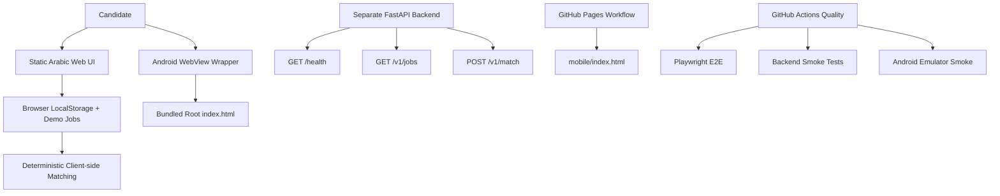

# InWork — Arabic-First Work & Opportunity Discovery Beta

[](https://zopair.github.io/inwork/)
[](android/)
[](backend/)
[](#proof-of-concept--enterprise-customization-readiness)

**InWork is an Arabic-first, mobile-first prototype for discovering remote, home-based, freelance, part-time, and local opportunities using a candidate profile and deterministic skills matching.**

The current experience uses local demo data and browser/device storage. It is not a live job marketplace: employer verification, real job feeds, production OAuth, application submission, and a persistent production backend are not implemented.

**Live preview:** [https://zopair.github.io/inwork/](https://zopair.github.io/inwork/)

## 1. Project Overview & Problem Statement

People looking for flexible work often need to search across fragmented listings and translate their skills, language ability, experience, location, and work preferences into relevant opportunities. InWork explores a short onboarding flow and transparent local matching to make opportunity discovery easier.

Current prototype areas:

- Arabic-first RTL onboarding and legal-consent screen.
- Candidate profile with governorate, skills, languages, experience, interests, and preferred work modes.
- Deterministic matching against a small, hard-coded opportunity catalogue.
- Result categories, filters, opportunity details, and local favorites.
- A mobile map view using OpenStreetMap and optional device geolocation.
- Free-course suggestions and a demo admin view with five sample personas.
- Static PWA shell and an Android WebView wrapper.
- A small FastAPI backend with health, jobs, and matching endpoints, currently separate from the front-end flow.

The product direction includes home-based work and flexible opportunities. The current application is not yet a women-only marketplace and does not implement dedicated women-specific verification, safety, privacy, or support workflows.

### Architecture



The web deployment, root browser test target, Android-bundled page, and FastAPI service are separate surfaces. They are not currently one integrated production stack.

## 2. Tech Stack & Versions

| Layer | Technology |
|---|---|
| Web UI | Native HTML, CSS, JavaScript |
| Mobile PWA | Web App Manifest, Service Worker, browser storage |
| Android wrapper | Java, Android WebView |
| Android Gradle Plugin | 8.7.3 |
| Android SDK | compileSdk 35, targetSdk 35, minSdk 23 |
| Android CI Gradle | 8.11.1 |
| Backend | FastAPI 0.116.1, Uvicorn 0.35.0, Pydantic 2.11.7 |
| Browser E2E | Playwright 1.55.0 |
| Web CI runtime | Node.js 20 |
| Backend CI runtime | Python 3.12 |
| Hosting | GitHub Pages |
| Map | OpenStreetMap embed |

The root [`package.json`](package.json) declares Playwright as a development dependency. Backend dependencies are pinned in [`backend/requirements.txt`](backend/requirements.txt). Android uses Gradle configuration under `android/`.

## 3. Prerequisites & Dependencies

For the web app:

- A modern browser.
- Python 3 for a local static HTTP server (optional).

For browser E2E tests:

- Node.js 20 and npm.
- Playwright Chromium.

For the backend:

- Python 3.12 recommended.
- pip.

For Android:

- JDK 17.
- Android SDK 35.
- Gradle 8.11.1 (CI installs it).
- Android Studio/emulator for local device validation.

No production OAuth credentials, database, payment service, or paid AI API is required to run the current local demo.

## 4. Installation & Local Setup

Clone the repository:

```bash
git clone https://github.com/zopair/inwork.git
cd inwork
```

### Run the root web prototype

```bash
python -m http.server 8000
```

Open `http://localhost:8000/index.html`.

### Run the Pages/mobile variant locally

The Pages workflow deploys `mobile/index.html` as its site root. To preview that exact file, serve the repository and open:

`http://localhost:8000/mobile/index.html`

### Run browser E2E tests

```bash
npm install --no-audit --no-fund
npx playwright install chromium
npx playwright test --config=playwright.ci.config.js
```

### Run backend smoke tests

```bash
python -m venv .venv
source .venv/bin/activate
python -m pip install -r backend/requirements.txt
cd backend
python -m unittest test_smoke.py -v
```

### Run the FastAPI backend

From the repository root after installing backend dependencies:

```bash
uvicorn backend.app.main:app --host 127.0.0.1 --port 8000
```

Endpoints:

- `GET /health`
- `GET /v1/jobs`
- `POST /v1/match`

These endpoints use a hard-coded in-memory job catalogue. The static front-end does not currently call them.

### Build the Android APK

From the repository root:

```bash
cd android
gradle :app:assembleDebug --no-daemon
```

The CI workflow copies the root `index.html`, `manifest.webmanifest`, and `sw.js` into Android assets before building the APK.

## 5. Environment Variables

The web prototype requires no environment variables. Candidate profiles and favorites are stored locally in browser/device storage.

The backend currently has no external service credentials or database configuration.

| Variable / setting | Current status |
|---|---|
| Google OAuth Client ID | Not configured; root UI's Google path is a demo placeholder, not real OAuth |
| Job-feed API credentials | Not configured; opportunity lists are hard-coded demo data |
| Database URL | None; backend catalogue is in memory |
| Payment credentials | None; no payment or payout integration |
| Map credentials | None; OpenStreetMap embed is used |
| `GITHUB_TOKEN` | Not required by the read-only CI jobs |

Do not add real user contact data, identity documents, OAuth secrets, or employer credentials to the repository.

## 6. Usage Guide & Core Features

### A. Candidate onboarding

The root UI provides:

1. Welcome and demo admin entry.
2. Terms and disclaimer acknowledgement.
3. Guest profile creation and a Google-demo button.
4. Profile fields for governorate, age group, contact, status, skills, languages, experience, work preferences, and interests.
5. Optional free-text notes.
6. A deterministic result screen with ranked opportunity categories.

The Google button in the root UI simulates a signed-in state. It does not authenticate with Google.

### B. Matching logic

The root front-end and FastAPI backend use deterministic rules, not an AI model.

The backend `rank_jobs` function scores:

- Skill overlap.
- Work-mode overlap.
- Language compatibility.

An English-language mismatch applies a large negative score and excludes the job. The front-end contains a separate matching implementation; the two algorithms are not currently unified.

### C. Demo opportunities

The root UI and mobile variant include hard-coded sample opportunities such as virtual assistance, data entry, customer support, design, bookkeeping, home-based sewing/embroidery, delivery, and junior frontend tasks.

Income values, job titles, and opportunity details are demonstration content, not verified vacancies or guaranteed earnings.

### D. Mobile map and saved opportunities

The mobile variant uses an OpenStreetMap iframe and browser geolocation where available. Favorites and profile details are stored locally. The map does not prove that a job is currently available at the displayed location.

### E. PWA and Android

- The web app includes a manifest and service worker.
- The Android app loads a bundled HTML page in a WebView.
- The Java bridge exposes location and external-link helpers.
- Android CI installs the APK in an emulator and checks the WebView readiness log marker.

### F. FastAPI backend

The separate backend exposes health, a hard-coded jobs catalogue, and a deterministic matching endpoint. No database, authentication, admin API, employer portal, real job ingestion, or front-end API integration is present.

### G. Workflow behavior and important differences

- `.github/workflows/pages.yml` publishes `mobile/index.html` to GitHub Pages.
- `.github/workflows/quality.yml` tests the root `index.html`, runs backend smoke tests, then runs Android emulator validation and creates an APK artifact.
- `.github/workflows/android.yml` validates and builds an APK using the root `index.html`.
- `.github/workflows/self-heal.yml` has `contents: write` and can commit a targeted `index.html` repair directly to `main` when it detects the configured browser-global collision. This is an automated write path, not a PR-only review path.

Because the Pages workflow serves the mobile variant while E2E and Android use the root page, passing tests on one surface do not guarantee identical behavior on the deployed web page and Android app.

## 7. Live Demo & Screenshots

<badge color="success">GitHub Pages deployed</badge>

- **Web preview:** [https://zopair.github.io/inwork/](https://zopair.github.io/inwork/)
- **Android build:** produced as a GitHub Actions artifact by the Android workflow.
- **Backend:** local-only FastAPI endpoints; no hosted backend URL is configured.

The latest observed Pages deployment run on 12 November 2026 succeeded. This does not establish that the backend is deployed or that demo opportunities are live vacancies.

## 8. Testing & Verification

### Local commands

```bash
# Browser tests
npm install --no-audit --no-fund
npx playwright install chromium
npx playwright test --config=playwright.ci.config.js

# Backend tests
python -m pip install -r backend/requirements.txt
cd backend
python -m unittest test_smoke.py -v

# Android build
cd ../android
gradle :app:assembleDebug --no-daemon
```

### CI evidence observed during this review

- **Deploy InWork Beta to GitHub Pages:** run #43128317913 on 12 November 2026 — Success.
- **InWork Android APK:** run #43128317950 on 12 November 2026 — Success.
- **InWork Self-Heal:** run #43128317850 on 12 November 2026 — Success.
- **InWork Continuous Quality:** run #43128318030 on 12 November 2026 — Failure overall. Backend smoke tests passed and Windows browser E2E passed; Ubuntu failed during Playwright Chromium installation, so the Android emulator and APK release-candidate jobs were skipped in that workflow run.

The separate Android APK workflow succeeded, but this is not equivalent to the full quality workflow's emulator smoke test. Re-run the full quality workflow after resolving the Ubuntu Chromium installation issue.

## Proof of Concept & Enterprise Customization Readiness

**Status: Beta / PoC with deployed static web surface, Android WebView build, and separate backend smoke-tested locally in CI. Not production-ready.**

| Capability | Current state |
|---|---|
| Arabic-first web onboarding | Implemented |
| Demo admin personas | Implemented in root UI |
| Opportunity matching | Deterministic local heuristics |
| Home-based / remote opportunity examples | Hard-coded demo catalogue |
| Verified live jobs | Not implemented |
| Google OAuth | Demo placeholder only |
| Profile persistence | Browser/device local storage only |
| FastAPI jobs/match endpoints | Implemented with in-memory catalogue |
| Front-end/backend integration | Not implemented |
| Employer verification / moderation | Not implemented |
| Payments / payouts | Not implemented |
| Production legal text | Requires legal review |
| PWA / service worker | Implemented |
| Android WebView APK | Build workflow succeeded; full emulator gate needs a green quality run |
| GitHub Pages | Deployed mobile variant |
| Self-heal automation | Can push a targeted edit directly to main |
| Privacy / security review | Not equivalent to a production audit |
| Project license | No root `LICENSE` file was present in the reviewed tree |

### Readiness gates

1. Choose one canonical web experience and align Pages, Playwright, and Android assets.
2. Connect the FastAPI service only after defining authentication, persistence, data retention, and API contracts.
3. Replace hard-coded opportunities with verified, moderated sources and clear expiry/source attribution.
4. Implement real OAuth only with approved provider configuration and secure redirect handling.
5. Add fraud reporting, employer verification, user privacy controls, and legal review.
6. Rework self-healing to open a PR rather than pushing directly to main.
7. Resolve the Ubuntu Playwright Chromium installation failure and obtain a green end-to-end quality run.
8. Align the older Ismailia local-services brief with the current remote/home-based opportunity product scope.

## Intellectual Property & Authorship

Project authorship and attribution: **Aly Hussein Zopair (علي حسين زبير ALY HUSSEIN ZOPAIR)**.

This attribution does not create a software license or override third-party job-listing, map, font, framework, or other asset rights.
